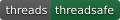
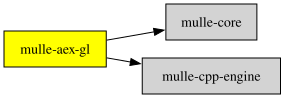

# mulle-aex-gl

Part of [MulleUI](https://github.com/MulleUI) — UIKit-shaped modular GUI libraries for mulle-objc.

#### 🪂 Software OpenGL ES 2.0 for headless MulleUI rendering

`mulle-aex-gl` is a [mulle-sde](//github.com/mulle-sde) C library fork of
[Aex-GL](https://github.com/kingletbv/aex-gl), a dependency-free software
implementation of OpenGL ES 2.0.

The purpose of the fork is to provide MulleUI with a self-contained GLES2
backend for headless rendering, without Carburetta at build or run time
and without EGL, X11, Wayland or a GPU and with some bug fixes.

- upstream: `kingletbv/aex-gl`, Apache-2.0
- fork base: see [UPSTREAM.md](UPSTREAM.md)


| Release Version                                       | Release Notes  | AI Documentation
|-------------------------------------------------------|----------------|---------------
|      [](//github.com/MulleUI/mulle-aex-gl/actions) | [RELEASENOTES](RELEASENOTES.md) | [DeepWiki for mulle-aex-gl](https://deepwiki.com/MulleUI/mulle-aex-gl)


## Status

The mulle-sde build integration is in place:

- the GLSL parser is hand-written (`src/glsl_es_1.c`); the original
  `grammar/glsl_es_1.cbrt` is archived and not built,
- the preprocessor is provided by `mulle-cpp-engine` (`mulle-cpp-lexer` is
  pulled in with it), so there are no generated preprocessor sources or
  Carburetta build/runtime dependencies,
- threading uses mulle-core (`mulle-thread`), not raw pthreads or Win32,
- `mulle-sde craft` builds `libmulle-aex-gl`,
- `mulle-sde test run` passes the headless GLES2 clear/readpixels test.

Upstream implements:

- vertex and fragment shader compilation and execution at GLSL ES 1.00 level,
- 32-bit RGBA framebuffer,
- 16-bit stencil buffering,
- 16- and 32-bit depth buffering,
- all blending modes,
- lines and triangles,
- `dFdx()`, `dFdy()` and `fwidth()`.

Missing upstream: points and MSAA.

## Build

This is a [mulle-sde](//github.com/mulle-sde) project. mulle-sde combines
recursive package management with cross-platform builds via **cmake**:

| Action  | Command                               | Description               |
|---------|---------------------------------------|---------------------------|
| Build   | `mulle-sde test craft`                | Builds the library and test project |
| Test    | `mulle-sde test run`                  | Runs the headless tests |
| Check   | `mulle-sde check`                     | Fast syntax check |
| Reflect | `mulle-sde reflect`                   | Regenerate CMake file lists |

With vibecoding enabled and a `test/` folder present, `mulle-sde craft` is
intentionally disabled; use `mulle-sde test craft` instead.

The headless regression suite is `mulle-sde test run`. Visual demos live under
`demo/` and use SDL; `demo/src/main-pixi-filters.c --dump-scene PATH` renders
the shared scene to a BMP without opening a window.

### You are here




## Add

Use [mulle-sde](https://mulle-sde.github.io/) to add mulle-aex-gl to your project:

``` sh
mulle-sde add github:MulleUI/mulle-aex-gl
```

To only add the sources of mulle-aex-gl with dependency
sources use [clib](https://github.com/clibs/clib):


``` sh
clib install --out src/MulleUI MulleUI/mulle-aex-gl
```

Add `-isystem src/MulleUI` to your `CFLAGS` and compile all the sources that were downloaded with your project.


## Install

Use [mulle-sde](https://mulle-sde.github.io/) to build and install mulle-aex-gl and all dependencies:

``` sh
mulle-sde install --prefix /usr/local \
   https://github.com/MulleUI/mulle-aex-gl/archive/latest.tar.gz
```

### Manual Installation

Install the requirements:

| Requirements                                 | Description
|----------------------------------------------|-----------------------
| [mulle-core](https://github.com/mulle-core/mulle-core)             | 🧱 Core C libraries (thread, container, allocator)
| [mulle-cpp-engine](https://github.com/mulle-cc/mulle-cpp-engine)             | ⚙️ C preprocessor engine
| [mulle-cpp-lexer](https://github.com/mulle-cc/mulle-cpp-lexer)             | 🔤 C preprocessor lexer

Download the latest [tar](https://github.com/MulleUI/mulle-aex-gl/archive/refs/tags/latest.tar.gz) or [zip](https://github.com/MulleUI/mulle-aex-gl/archive/refs/tags/latest.zip) archive and unpack it.

Install **mulle-aex-gl** into `/usr/local` with [cmake](https://cmake.org):

``` sh
PREFIX_DIR="/usr/local"
cmake -B build                               \
      -DMULLE_SDK_PATH="${PREFIX_DIR}"       \
      -DCMAKE_INSTALL_PREFIX="${PREFIX_DIR}" \
      -DCMAKE_PREFIX_PATH="${PREFIX_DIR}"    \
      -DCMAKE_BUILD_TYPE=Release &&
cmake --build build --config Release &&
cmake --install build --config Release
```

## Third-party notices

The PixiJS filter shaders adapted in `demo/src/main-pixi-filters.c` come from
[pixi-filters](https://github.com/pixijs/filters) and are MIT-licensed; see
[demo/LICENSES/PixiJS-Filters.txt](demo/LICENSES/PixiJS-Filters.txt). The
browser comparison harness loads PixiJS and pixi-filters from jsDelivr at
runtime; both are MIT-licensed.

## License

Apache License 2.0. See [LICENSE](LICENSE). This fork preserves the upstream
license and attribution.

## Author

[Nat!](https://mulle-kybernetik.com/weblog) for Mulle kybernetiK  


